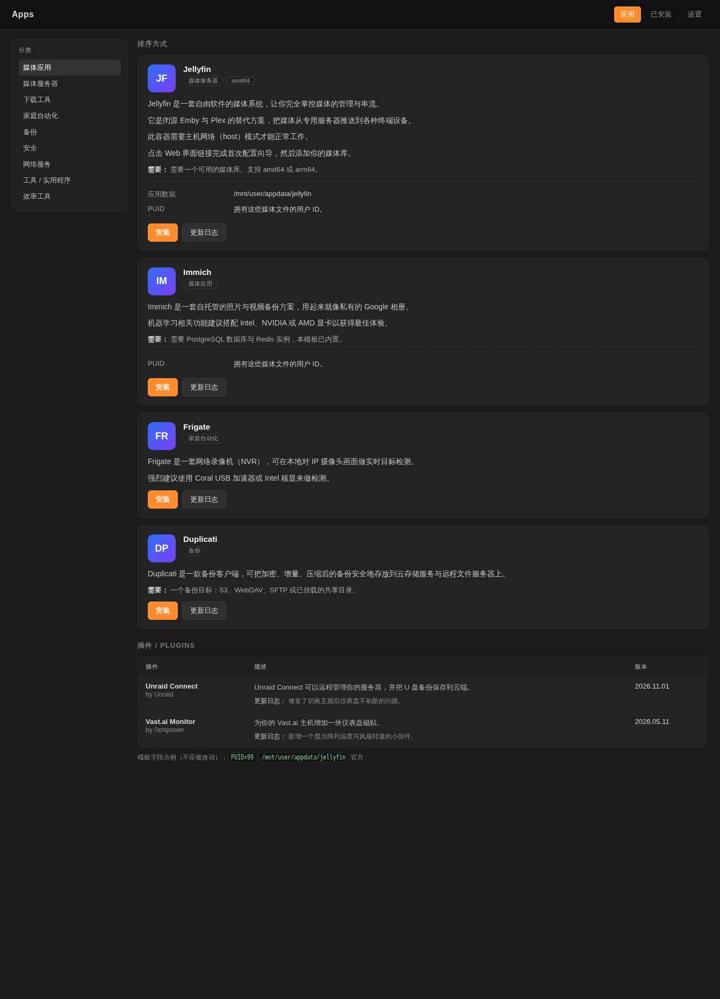
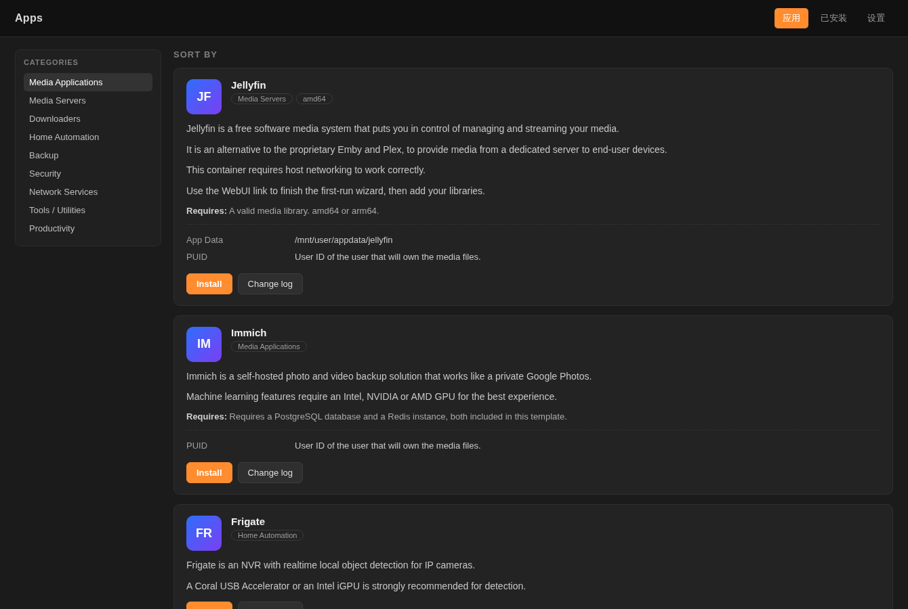

# Unraid 插件中文化（unraid.zh.translator）

把 **Unraid 的应用商店（Community Applications / Apps）** 里的英文文案在浏览器端替换成简体中文
（默认只处理这一页；需要时可在设置里把范围扩到原生插件页 / Docker 页）。译文由**你自己配置的大模型**（任何 OpenAI 兼容接口）生成，
并按「文本内容哈希」缓存：

> 插件没更新 → 文案没变 → 直接复用旧译文，**不再调用模型**；
> 插件更新了 → 只有变化的那几段产生新哈希 → **只重译变化的片段**。

## 安装地址（Unraid「安装插件」页填这一条，之后可自动更新）

```
https://raw.githubusercontent.com/jiege6-66/unraid-zh-translator/main/unraid.zh.translator.plg
```

仓库：<https://github.com/jiege6-66/unraid-zh-translator>

**启用后**（Chromium 实测截图）：



**同一页面未启用时**：



---

## 1. 它解决什么问题

Unraid 6/7 的界面汉化包只覆盖系统自带页面；商店里的应用简介、运行要求、模板字段说明、
分类名、已装插件的描述与更新日志，全是英文。这个插件补上这一层：

- 不动 CA 插件的一行代码，也不改 dynamix 模板；
- 只在**展示层**把英文文本替换成中文，DOM 结构、按钮、表单全部保持原样；
- 卸载后立刻恢复原样（不修改任何宿主文件）。

---

## 2. 数据从哪来

**优先复用 CA 插件自己的缓存，不重复下载。**

CA 每次刷新都会把应用源解压到 `/tmp/GitHub/AppFeed/applicationFeed.json`（见 CA 的
`include/paths.php` → `application-feed-local`）。本插件直接读这个文件，因此：

- 内容与商店里显示的**完全一致**（同一份数据）；
- 不额外消耗 22MB 流量，U 盘/内存都没压力；
- 判断新旧只看官方那个 37 字节的 `applicationFeed-lastUpdated.json`：
  两边 `last_updated_timestamp` 一致就直接用本地，不一致才去下载。

| 设置 `应用源` | 行为 |
|---|---|
| `auto`（默认） | 本地缓存够新（或时间戳一致）就用本地；否则下载到 `var/applicationFeed.json` |
| `local` | 只用 CA 本地缓存；没找到会提示「先打开一次 Apps 页面」 |
| `online` | 只下载（官方 CDN → GitHub 备份） |

在线主源是 CA 官方 CDN `https://assets.ca.unraid.net/feed/applicationFeed.json`，
失败自动退回 `Squidly271/AppFeed` 的 GitHub 备份，再失败则退回旧的本地数据（并在日志里说明）。

## 3. 工作原理

```
浏览器（Unraid WebUI 任意页面）
 ├─ store-zh-inject.page（Menu='Buttons' / Link='nav-user'）注入两个脚本
 ├─ js/uzt-norm.js     文本规范化（与 PHP 侧逐字符一致）
 └─ js/store-zh.js     扫描文本节点 + title/placeholder/alt/aria-label
                       含中文的「混合段落」按行拆分，只补译纯英文行
        │  POST 批量文本（≤48 条 / ≤6000 字符）
        ▼
   ajax/lookup.php
        │
        ├─ 规范化 → sha1 → 查 SQLite
        │     命中 → 直接返回中文
        │     未命中 → 入库(kind=live)
        │              └─ AUTO_NEW=1 且字符数 ≤ SYNC_MAX_CHARS → 当场调模型翻译并返回
        ▼
   浏览器把返回的译文写回 DOM（MutationObserver 持续跟进 SPA 重渲染）
```

后台还有一条**批量通道**（`scripts/worker.php`）：

```
sync      抓 CA 应用源（约 22MB / 5700+ 应用）→ 抽片段 → 按 hash 去重入库
translate 把待译队列分批送模型 → 写回译文（受时间预算约束，可被 cron 反复续跑）
```

两条通道共用同一张表，所以**页面按需翻过的内容，批量任务不会重复翻**；反过来也一样。

### 缓存键为什么能实现「更新才重译」

数据库主键是 `sha1(normalize_text(原文))`：

| 场景 | 原文 | hash | 结果 |
|---|---|---|---|
| 插件未更新 | 不变 | 不变 | 命中，0 次模型调用 |
| 插件改了简介第 2 段 | 该段变化 | 新 hash | 只翻这 1 段，其余照旧 |
| 同一句话出现在两个应用里 | 相同 | 同一 hash | 只翻 1 次，两处共用 |
| 同一句话改了一个词 | 变化 | 新 hash | 重译该句（旧译文仍留在库里，回滚后可直接复用） |

实测：把应用源里某个应用的简介改一句、加一句，再同步 + 翻译，
模型收到的**只有那 2 条**，其余 18 条全部复用缓存（见 `tests/run-tests.sh` 第 7 步）。

---

## 4. 安装与更新

### 方式 A：从 URL 安装（推荐，可自动更新）

1. WebUI → **插件（Plugins）→ 安装插件（Install Plugin）**
2. 填入：
   `https://raw.githubusercontent.com/jiege6-66/unraid-zh-translator/main/unraid.zh.translator.plg`
3. 点「安装」。之后只需要在插件页点 **检查更新**，Unraid 会比对 `.plg` 里的 `version`，
   有新版就原地覆盖安装。

**覆盖式更新**：安装脚本第一步就会 `rm -rf` 掉插件目录，并清理
`/usr/local/emhttp/plugins/*unraid.zh.translator*` 与 `/boot/config/plugins/*unraid.zh.translator*.plg`
里的历史副本（旧文件改名为 `.removed` 保留可回滚），所以**不会出现两个同名插件**。
配置与词库在 `/boot/config/plugins/unraid.zh.translator/`，更新不会动它们。

### 方式 B：本地文件安装（不会自动更新）

```bash
plugin install /path/to/unraid.zh.translator.plg
```

更新时重跑一次同样命令即可（会覆盖，不会重复）。

安装后菜单出现：**设置 → 插件中文化**。

> 安装脚本只做三件事：把文件铺到 `/usr/local/emhttp/plugins/unraid.zh.translator/`、
> 建 `/boot/config/plugins/unraid.zh.translator/`、写入默认配置（已存在则不覆盖）。

---

## 5. 配置

打开 **设置 → 插件中文化 → 大模型**，填三项就行：

| 项 | 说明 | 例子 |
|---|---|---|
| API 地址 | 到 `/v1` 为止，程序会拼 `/chat/completions` | `https://api.deepseek.com/v1` |
| API Key | 只存在本机（0600 权限），不回传浏览器 | `sk-...` |
| 模型 | 模型名 | `deepseek-chat` |

常见服务：

| 服务 | API 地址 | 模型示例 |
|---|---|---|
| DeepSeek | `https://api.deepseek.com/v1` | `deepseek-chat` |
| OpenAI | `https://api.openai.com/v1` | `gpt-4o-mini` |
| Moonshot | `https://api.moonshot.cn/v1` | `moonshot-v1-8k` |
| 智谱 | `https://open.bigmodel.cn/api/paas/v4` | `glm-4-flash` |
| 硅基流动 | `https://api.siliconflow.cn/v1` | `Qwen/Qwen2.5-7B-Instruct` |
| one-api / NewAPI 中转 | `http://中转地址/v1` | 按中转配置 |
| **本地 Ollama** | `http://[服务器IP]:11434/v1` | `qwen2.5:14b`（Key 可留空） |
| **本地 LM Studio** | `http://[服务器IP]:1234/v1` | 任意已加载模型 |

填完点 **测试连接**，会返回一次真实翻译样例（耗时、原文、译文）。不通就在这里报错。

---

## 6. 使用

0. 商店页面**右下角有「中 / EN」切换**（也可按 `Alt+T`）：随时对比原文与译文，选择会记住。
1. **同步应用源**：解析商店数据（复用 CA 本地缓存时只要 1～2 秒），把英文片段入库。
2. 打开 **应用（Apps）** 页面 → 当前屏幕上的英文简介会被翻译；
   往下一滚，新出现的卡片继续翻译。
3. 想一次性把全部内容翻好（离线也全中文）：
   **词典与任务 → 翻译待译队列**。受 `单次运行预算`（默认 300 秒）限制，
   跑完一段会自动停，再点一次或等 cron 继续。

### 翻译什么，不翻译什么

只翻**简介类内容**（这是刻意收紧的；**策略升级后第一次同步会自动清掉旧版本误采的短文本**，应用源里的分类名/字段名不受影响）：

| 会翻译 | 不翻译 |
|---|---|
| 应用简介 Overview（整段文字） | 应用名 / 品牌名（Jellyfin、Immich、Sonarr…） |
| 运行要求 Requires | 镜像名、tag、路径、命令参数、环境变量 |
| 模板字段说明、字段名 | 按钮字、标签、纯数字/版本号 |
| 分类名称、更新日志 | 单行中英混排（`GPU 温度/Fan speed` 保持原样） |

页面按需采集时，新文本必须满足「≥ 40 字符或 ≥ 6 个英文单词」才会送模型，
所以 **名称类短文本根本不会进入翻译队列**（设置项 `LIVE_MIN_CHARS` 可调）。

### 成本与耗时（真实数据，2026-11 的应用源）

| 指标 | 数值 |
|---|---|
| 应用数 | 5 758（有文案的 5 610） |
| 抽出片段 | **约 6.4 万条**（简介 15 444 / 模板字段说明 30 058 / 字段名 16 426 / 运行要求 1 765 / 分类 25 …） |
| 原文字符 | 约 **542 万** |
| 全量翻译请求数 | **约 1 600 次**（每批 48 条 / 6000 字符） |
| 词库体积 | SQLite 约 **27 MB** |
| 管线自身开销 | 全量 63 889 条入库+写回 ≈ **16 秒**（不含模型时间） |

- **日常用法（推荐）**：什么都不用点，浏览时按需翻译。一屏通常只有几十条，1～3 次请求。
- **全量预翻译**：1 600 次请求 × 单次 3～10 秒 ≈ **1.5～4.5 小时**，适合挂 cron 过夜跑。
  用便宜快的模型（`gpt-4o-mini` / `deepseek-chat` / 本地 7B）成本可忽略。

---

## 7. 设置项

| 设置 | 默认 | 说明 |
|---|---|---|
| 启用翻译 | 开 | 总开关；关掉后注入脚本不再输出 |
| 生效页面 | 仅应用商店 | `store`（默认）/ `store_plugins` / `all`（含 Docker 页） |
| 应用源 | 自动（复用 CA 缓存） | `auto` / `local` / `online`，见上文 |
| 在线源地址 | 官方 CDN | `assets.ca.unraid.net`，失败退 GitHub 备份 |
| 自动翻译新文案 | 开 | 页面上没见过的英文是否送模型 |
| 页面加载即翻译 | 开 | 关掉则只显示已有译文，新文案留给后台任务 |
| 单次同步翻译上限 | 4000 字符 | 超过就先入队，避免页面等太久 |
| 简介阈值 LIVE_MIN_CHARS | 40 | 页面新文案低于此长度且词数 <6 时不翻译（名称保护） |
| 最大尝试次数 | 8 | 失败按 2ⁿ 分钟退避重排，超过才彻底放弃 |
| 自动续跑 | 开 | 到达时间预算且队列未空时自动开下一轮（链长上限 40） |
| 慢模型保护 | 自动 | 上次平均耗时 >15 秒/批时，页面不再同步等译文，改为后台排队（概览会显示「模型 X 秒/批（较慢…）」） |
| 每小时同步翻译预算 | 120000 字符 | 超出后只入队（0=不限），防止某个页面把额度刷爆 |
| JSON 模式 | auto | 不支持 `response_format` 的服务会自动降级重试 |
| 温度 | 0.2 | 翻译任务建议保持低值 |
| 每请求条数 / 字符 | 48 / 6000 | 批量大小，影响请求数与单请求耗时 |
| 超时 / 重试 | 90 秒 / 2 次 | 429、5xx、超时自动指数退避重试 |
| 单次运行预算 | 300 秒 | 后台任务每轮最多跑多久 |
| Cron | 空 | 例如 `0 4 * * *`，每天自动同步 + 续跑队列 |
| PHP CLI 路径 | 自动探测 | 仅当「后台任务启动失败」时手填；会自动跳过 php-fpm/php-cgi |
| 应用源地址 | Squidly271/AppFeed | 可换镜像；失败会自动试备用源 |
| 不翻译应用名称 | 开 | 品牌名（Jellyfin、Immich…）保持英文 |

配置文件：`/boot/config/plugins/unraid.zh.translator/translator.cfg`（INI，权限 600）。
词库：同目录 `translations.db`（SQLite，回滚日志 + 完整同步，掉电可自动回滚；
万一损坏会被自动隔离并重建，代价是重新翻译）。日志：`logs/worker.log`（自动截断到约 1MB）。

---

## 8. 数据与隐私

- 发给模型的**只有界面文案**（应用简介、字段说明这类公开文本），不包含任何账号、
  硬盘序列号、IP、配置内容。
- 除「应用源地址」和你配置的模型接口外，插件不访问任何第三方服务，无遥测；
  默认还会复用 CA 已经缓存好的应用源，连这次下载都省掉。
- API Key 只落在本机 `translator.cfg`；设置页回传时用占位符，任何接口都不会把它吐给浏览器。
- 所有写操作（保存设置、触发任务）都要求 Unraid 的 `csrf_token`；读不到 token 时一律拒绝，
  不回落到 Cookie（避免退化成可伪造的双提交）。
- `ajax/configjs.php` 只对同源页面开放（校验 `Sec-Fetch-Site`/`Referer`），并带 `nosniff`。
- Cron 表达式走白名单校验，换行等字符不会写进 crontab 文件。
- 「清除已保存的密钥」是显式开关，勾选后会把 Key 从配置里真正删掉。

---

## 9. 故障排查

| 现象 | 原因 / 处理 |
|---|---|
| 点「同步应用源」没反应，日志里是 `Usage: php-fpm …` | php-fpm 进程里的 `PHP_BINARY` 指向 FPM；本版会探测真正的 PHP CLI（并校验能执行 PHP 代码）。设置页「环境自检」会显示探测结果，异常时可手填 PHP CLI 路径 |
| 页面完全没变化 | ① 设置里「启用翻译」是否开；② 生效页面是否包含当前页；③ F12 控制台看 `window.__UZT__` 是否存在；④ 浏览器插件（广告拦截）是否挡了 `/plugins/unraid.zh.translator/*` |
| 只有部分中文 | 正常。译文按需生成，滚动后会继续；或去「词典与任务」点「翻译待译队列」 |
| 测试连接 401/403 | Key 错或该服务不支持 Bearer；Ollama 可留空 Key |
| 测试连接超时 | 地址要填到 `/v1`；容器里访问宿主用 Unraid 的 IP（不是 `127.0.0.1`） |
| 返回不是 JSON 的报错 | 模型太弱/被中转改写。把「JSON 模式」改成 `off` 再试 |
| 翻译结果被截断 | 调大「超时」，或把「每请求字符」降到 3000 |
| 词库越来越大 | 属正常（约 27MB）。可在「词典与任务 → 清理已下架词条」删掉商店里已消失的条目 |
| 保存设置提示「写入失败」 | `/boot` 只读或已满（U 盘写保护、满了）。检查 `df -h /boot` |
| 想让它自动一直翻 | 「自动续跑」默认开启：到预算就自动开下一轮；完全无进展时会自动停，避免烧额度 |
| 翻译进度在哪看 | 日志里每批一行 `翻译进度：本轮完成 X，失败 Y，剩余 Z，速度 …，按此速度还需 …` |
| 失败片段会重试吗 | 会：按 2ⁿ 分钟退避自动重排，最多 8 次；修好 Key 后可点「重试失败片段」立刻重来 |
| 队列太大/太杂 | 点「精简队列（只保留简介类）」清掉短文本与本机插件片段；或「清空未译队列」改为纯按需 |
| 想从头重来 | 「清空全部译文重新开始」（不影响设置） |
| 日志在哪 | 设置页「日志」标签页，或 `/boot/config/plugins/unraid.zh.translator/logs/worker.log` |

---

## 10. 卸载

WebUI → 插件 → 点插件旁的「移除」。RAM 里的文件立即消失，页面恢复英文。

如需彻底清干净（含词库与密钥）：

```bash
rm -rf /boot/config/plugins/unraid.zh.translator
rm -f /boot/config/plugins/dynamix/unraid.zh.translator.cron
```

---

## 11. 已知限制

- **不翻译品牌名**：应用名、镜像名、作者名保持英文（设置里可关掉 `不翻译应用名称`，
  但通常没必要）。
- **只做展示层替换**：不改后端返回的 JSON，所以 CA 自己的搜索仍按英文匹配
  （搜 "backup" 依然能搜到，只是结果显示中文）。
- **CA 前端改版**：译文匹配基于文本内容而非 DOM 结构，所以改版一般不受影响；
  但如果 CA 把简介改成富文本/Markdown 渲染，屏幕上看到的字符串会和源里的不同，
  这时会自动按「屏幕上看到的字符串」重新翻译一次（多花一点额度，不会显示英文）。
- **超长段落**：单段超过 6000 字符会先按句末切块再翻；所有分片到齐才成稿，
  缺片时宁可不写库也不会存半截译文。
- **混合语言**：含中文的多行段落只补译其中的纯英文行（中文行原样保留）；
  单行内中英混排（如 `GPU 温度/Fan speed`）不动，避免破坏语义。
- **品牌名**：模型按要求保留原文时视为「已完成」，不会反复重试到永久失败。
- **U 盘写入**：词库在 `/boot`，一次全量翻译约几十 MB 写入量；日常按需翻译只有几百 KB。

---

## 12. 发布新版本（维护者）

```bash
./build.sh 2026.11.25        # 版本号必须比上一版大，Unraid 靠它判断"有更新"
git add -A && git commit -m "2026.11.25: 说明本次改动"
git push                     # 推到 main 后，用户在插件页点「检查更新」即可原地覆盖
```

- 打包会自动把 `dist/<name>.plg` 复制一份到仓库根目录（发布件），并做 XML 自检；
- 安装脚本会清理历史副本，所以更新后不会出现两个同名插件；
- `pluginURL` 固定指向 `raw.githubusercontent.com/.../main/<name>.plg`，
  用户装一次之后就不再需要手动下载。

## 13. 开发与测试

```bash
./build.sh 2026.11.25      # 生成 dist/*.plg 与仓库根目录的发布件（自包含，内联全部文件）

# ① 任意机器（含 CI，无需 root、不写系统目录）—— 34 项核心断言
php tests/core.php        # 34 项
node tests/norm_parity.mjs && node tests/rules_parity.mjs && node tests/dom.test.mjs
php tests/policy.php && php tests/render_page.php

# ② 有 Unraid/root 的机器 —— 77 项全量回归（会覆盖安装到 /usr/local/emhttp）
sudo bash tests/run-tests.sh
```

代码里所有绝对路径都可以用环境变量重定向，方便在容器/CI 里跑：

| 变量 | 作用 | 生产默认 |
|---|---|---|
| `UZT_CFG_DIR` | 配置/词库目录 | `/boot/config/plugins/unraid.zh.translator` |
| `UZT_VAR_DIR` | 运行期缓存目录 | `/usr/local/emhttp/plugins/…/var`（不可写时回落） |
| `UZT_LOCK_DIR` | worker 锁文件目录 | `/var/lock` |
| `UZT_VAR_INI` | csrf_token 来源 | `/var/local/emhttp/var.ini` |
| `UZT_FAKE_CA_FEED` | 测试用假应用源 | 不设 |

`tests/run-tests.sh`（共 77 项断言）会依次验证：

1. 全部 PHP `php -l`、JS `node --check`
2. `build.sh` 打包 → 解析 `.plg` → 还原到 `/usr/local/emhttp/...` → **逐字节**比对源码
3. PHP 与 JS 的**文本规范化**一致（28 个坑：CRLF、NBSP、全角空格、零宽字符、BOM…）
4. PHP 与 JS 的**可译判定**一致（29 个用例：URL/镜像名/环境变量/版本号该跳过）
5. `.page` 渲染冒烟（无 PHP 警告、CSRF 存在、API Key 不出现在 HTML）
6. 假大模型 + 真 worker：同步 18 条 → 翻译 → 再跑一次 **0 次模型调用** → 改文案后**只翻 2 条**
7. 真 HTTP 端点：命中缓存 / 按需翻新文案 / CSRF 403 / 多段按行拼装 / status 统计
8. 加固项：9054 字符长文本跨批分片译文完整、品牌名原样返回算成功、密钥真正清除、
   Cron 白名单、configjs 跨站 403、每小时预算生效、失败片段可重放、词库崩溃安全日志模式
9. 后台任务启动链路：php-fpm 二进制被识破并回落、启动无输出时报失败、按钮真能拉起任务
   并出现 `worker 启动` 日志
10. 应用源解析：auto 复用 CA 本地缓存、时间戳一致时零下载、local 缺文件有可操作提示、
    online 落到自有缓存、范围=仅商店时不解析本机 .plg
11. 清理过期词条时保留页面采集的 live 词条
12. jsdom 前端 28 项断言：文本与属性替换、混合语言按行补译、code/中文/`data-uzt-skip` 不被动、
   SPA 后插入节点、不自我循环、不重复翻译

目录：

```
build.sh                                  打包器（内联文件，校验 CDATA）
src/usr/local/emhttp/plugins/unraid.zh.translator/
  unraid.zh.translator.page               设置页（Settings 菜单）
  store-zh-inject.page                    全局注入点（Buttons / nav-user）
  include/                                util · config · store · llm · source_feed · source_local · translator
  ajax/                                   lookup · status · settings · configjs
  scripts/worker.php                      sync / translate / all / cron / prune / stats / test
  js/                                     uzt-norm.js（规范化）· store-zh.js（替换引擎）
tests/                                    core.php（无需 root 的核心链路）
                                          mock_llm.py · install_plg.py · render_page.php · policy.php
                                          norm_parity.mjs · rules_parity.mjs · dom.test.mjs
                                          run-tests.sh + steps/（需要 root 的全量回归）
demo/                                     store.html（模拟商店）+ seed.php + shots/
```

调试小工具（浏览器控制台）：

```js
uzt.stats()        // 本轮采集/替换统计
uzt.rescan()       // 立即重扫当前页
uzt.disable()      // 本浏览器临时关闭（localStorage）
uzt.forceAllPages()// 强制在任意页面生效
```
